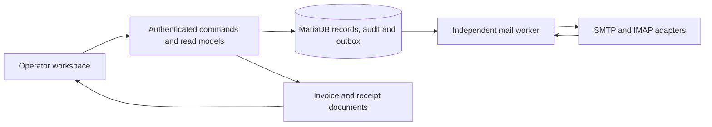

# Future engineering vision

## Executive summary

Keep the modular monolith and strengthen the boundaries where humans, external providers and durable financial records meet. The first goal is a predictable manual workflow with evidence for every consequential step. A more elaborate service architecture would increase coordination costs while the current bottlenecks are release integrity, delivery behavior, and incomplete operator workflows.

## Target shape

- **Explicit authority for side effects.** Make renewal detection, human customer-send approval, message delivery and reply review separate operations. Persist the reviewed address, body and correlation identifiers before transport. Protect archived automatic rows during the rollout. Provider acceptance and a confirmed business decision are distinct events. Keep AI classification and official invoice submission dormant under one effective policy understood by both API and worker. See **A-01**, **A-03**, **A-06**, **A-11**, **A-13**.
- **One financial source of truth per business fact.** Keep legal issuer and branding snapshots per invoice. Represent source explicitly and handle nullable subscriptions in the API and renderer. Preserve draft arithmetic and separately record official values. Model payment as an append-only ledger with an invoice-scoped balance, then snapshot a receipt only for a recorded payment. Role checks, lookups and transactions must preserve issuer and object scope. Do not use payout, payment, or mail data to infer renewal fulfillment. See **A-01**, **A-02**, **A-05**, **A-07**.
- **Bounded session with explicit revocation semantics.** Use the current refresh-session architecture, an absolute session expiry, and short access tokens. Define the revocation expectation for sensitive writes and reflect that in guard tests. Use API-side enforcement as the control plane. Browser state and hidden navigation only guide users. See **A-04**.
- **Operator views instead of raw orchestration states.** Derive consistent human-readable summaries from durable facts. Use the same accessible modal primitive, validation and feedback for settings and workflow forms. Separate routine work from configuration and advanced diagnostics. Keep exceptional states explainable rather than hiding them in a generalized status. See **A-09**, **A-13**, **A-14**.
- **Observable boundaries and repeatable releases.** Add bounded checks and alerts for worker progress, eligible outbox age, mail correlation exceptions, unknown delivery outcomes, and actionable reconciliation failures. Use structured operational logs with correlation IDs and omit message bodies and secrets by default. Maintain independent build and migration evidence tied to a release SHA, a compatibility matrix, and representative restore rehearsals. See **A-03**, **A-08**, **A-10**, **A-11**.

## Trade-offs

| Decision | Chosen direction | Alternative and when to revisit |
| --- | --- | --- |
| API and worker deployment | Shared domain in one repository with independent process supervision and coordinated rollout. | Separate services only if load or ownership boundaries demand them. A dedicated mail service now would introduce another command and data boundary. |
| Provider integration | Retain adapters and durable attempts. Disable active issuance and AI under the frozen scope. | Removing all previous integration code would discard useful test coverage and recovery history. Future enablement requires a separate owner decision and test plan. |
| Outbound delivery | One durable command for each human request with bounded retries and an explicit ambiguous state or approved retry policy. | Direct SMTP from a browser request sacrifices durability. Exactly-once external delivery cannot be guaranteed with ordinary SMTP and a separate local transaction. |
| Persistence | MariaDB relational constraints and additive migrations. Denormalize immutable documents where reproduction requires it. | A new datastore or event sourcing would increase replay and migration risks with no demonstrated need. Add indexes and query projections after measurement. |
| UI | Extend Next.js and share primitives and API contracts. | A wholesale rewrite would spend effort on stable features and put verified history and settings at unnecessary risk. |
| Auth | Keep local identity and improve bounded refresh. Measure the cost of targeted session validation for privileged commands. | Revocation checks on every request are simpler to reason about but add availability coupling and lookup load. Evaluate SSO only if account lifecycle needs justify it. |

## Essential and optional

Essential now means release-safe manual workflows, correct financial documents, bounded identity, restricted integrations, visible human ownership and recoverable mail. Once those are measured, refine query projections, worker backoff, deployment ergonomics and accessibility coverage. Product options such as collection analytics, finer role segmentation, more convenience templates, or approved provider support remain strategic proposals. No tenant model, automation rollout, or legal rule is assumed.

[Evidence register](CODEX_INITIAL_REPORT.md) · [Sequencing](CODEX_IMPLEMENTATION_PLAN.md)
